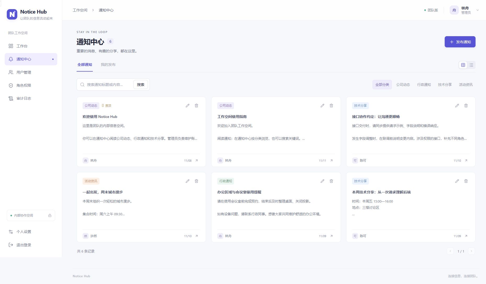

# Notice Hub · 内部通知与权限管理系统

Notice Hub 是一个已部署上线的团队通知与权限管理系统，基于 Spring Boot 和 Vue 构建，提供登录认证、角色权限、通知发布、成员管理和操作审计。

**在线访问：[https://129.211.14.37](https://129.211.14.37)**

## 使用系统

1. 打开在线地址，使用管理员分配的账号登录。
2. 在通知中心阅读、搜索和筛选团队通知；编辑可以发布并维护自己创建的通知。
3. 管理员通过用户管理创建成员、分配角色、启停账号，并在审计日志中查看关键操作。

用户可以在「个人设置」修改显示姓名和密码。线上账号由管理员统一分配；自行部署请参考 [云服务器部署与维护](docs/云服务器部署与维护.md)。

## 云端部署

系统运行在 Ubuntu 云服务器，Nginx 提供 HTTPS 并转发至 Spring Boot，MySQL 保存业务数据，Redis 管理登录会话。Vue 构建产物与后端同源提供。

- 已配置开机自启、异常退出重启和 HTTPS 证书自动续期。
- 每日备份数据库与配置，保留最近 7 天；备份已通过独立数据库恢复演练。
- 2026-11-17 云端接口与权限验收 **43 / 43 项通过**。
- 数据库、Redis 和后端端口仅供服务器内部访问，网站统一通过 HTTPS 入口提供服务。

详细步骤、更新和恢复操作见 [云服务器部署与维护](docs/云服务器部署与维护.md)，检查结果见 [云端部署验收](docs/云端部署验收.md)。

## 界面预览

下图使用开发环境中生成的虚构演示账号与通知内容。



## 已实现功能

| 模块 | 功能 |
|---|---|
| 工作台 | 实时通知统计、本人发布数量、最新通知；管理员查看团队数量与近期活动 |
| 登录认证 | 用户名密码登录、两小时有效期、多会话、退出、连续失败限流 |
| 通知中心 | 发布、详情、编辑、逻辑删除、关键词搜索、分类、我的发布、分页、管理员置顶 |
| 用户管理 | 创建成员、编辑姓名、启停账号、分配一个或多个角色 |
| 角色权限 | 三个固定角色、11项权限、角色成员数和权限矩阵 |
| 审计日志 | 登录结果、通知变更、账号启停、角色分配、资料和密码变更；搜索、筛选、分页 |
| 个人设置 | 显示姓名、验证旧密码后修改密码、修改后注销全部会话 |

密码使用带独立随机盐的 Argon2id 哈希保存。接口传参使用 DTO，拒绝未知字段，客户端不能注入创建人或角色。通知更新带版本号，阻止并发覆盖；停用和权限撤销在下一个请求生效。

## 从哪里学习

- [一步一步学习这个系统](docs/一步一步学习.md)：操作、代码位置、设计原因、观察方法。
- [需求与设计](docs/需求与设计.md)：边界、角色矩阵、ER图、验收目标。
- [接口说明](docs/API.md)：请求、权限、错误状态和示例。
- [云服务器部署与维护](docs/云服务器部署与维护.md)：部署过程、设计原因、日志、更新与恢复。
- [云端部署验收](docs/云端部署验收.md)：公网 HTTPS、权限、备份与续期检查结果。
- [本地开发与调试](docs/SETUP.md)：开发者配置环境、使用 IDEA 和 Vite 调试的方法。
- [安全说明](SECURITY.md)：漏洞报告、凭据管理和部署注意事项。
- [本机接口验收记录](docs/验收结果.md)、[本机浏览器验收记录](docs/浏览器验收.md)：上线前的开发环境验证。

## 技术与目录

| 技术 | 采用方式 |
|---|---|
| JDK 17 / Spring Boot 3.5.16 / Maven | 单个后端服务，按职责分包 |
| MyBatis-Plus 3.5.15 / MySQL 8 | 基础实体CRUD + 显式参数化SQL |
| Sa-Token 1.46.0 / Redis 7 | 云端会话存储与权限检查 |
| Flyway | 按版本自动执行数据库迁移 |
| Spring Security Crypto / Bouncy Castle | Argon2id 密码哈希；没有同时启用第二套登录框架 |
| Vue 3 / Vue Router / Vite / Lucide | 前端界面；构建后由后端同源提供 |

```text
notice-hub/
├─ backend/                  Spring Boot / Maven 工程
│  └─ src/main/
│     ├─ java/com/noticehub/
│     │  ├─ controller/      接口和参数接收
│     │  ├─ service/         业务规则和权限判断
│     │  ├─ mapper/          数据访问和SQL
│     │  ├─ domain/          数据库实体
│     │  ├─ dto/             输入字段和校验规则
│     │  ├─ config/          登录拦截、密码编码器、响应头、初始化
│     │  └─ common/          统一响应和异常处理
│     └─ resources/
│        ├─ application.yml
│        ├─ db/migration/    Flyway SQL
│        └─ static/          构建时生成的前端
├─ frontend/src/
│  ├─ pages/                六个业务页面和登录页
│  ├─ components/           图标、弹窗、分页
│  ├─ state.js              请求封装、会话和界面状态
│  └─ main.js               路由和页面入口
├─ scripts/                 构建、启动、停止、真实接口验收
├─ deploy/linux/            云端初始化、systemd、Nginx、备份与更新
├─ docs/                    设计、教学、API和验收材料
└─ .local/                  本机密码、运行PID、日志；不进入Git
```

需要核查的技术依据：[Spring Boot 3.5运行要求](https://docs.spring.io/spring-boot/3.5/system-requirements.html)、[Sa-Token路由拦截](https://sa-token.com/use/route-check.html)、[Sa-Token权限认证](https://sa-token.com/use/jur-auth.html)、[Sa-Token Redis集成](https://sa-token.com/up/integ-redis.html)、[MyBatis-Plus](https://baomidou.com/getting-started/)、[Vue](https://vuejs.org/guide/introduction.html)、[OWASP鉴权](https://cheatsheetseries.owasp.org/cheatsheets/Authorization_Cheat_Sheet.html)、[OWASP密码存储](https://cheatsheetseries.owasp.org/cheatsheets/Password_Storage_Cheat_Sheet.html)。这些资料用于理解框架和安全原则；项目业务边界和参数是本学习项目的设计约定。
