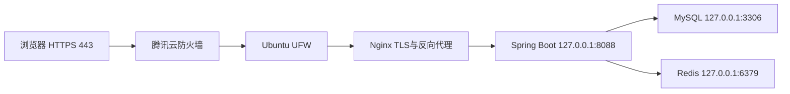

# 云服务器部署与维护

这份文档面向在自己的 Ubuntu 服务器上部署 Notice Hub 的开发者，说明首次初始化、HTTPS、备份、更新与恢复的操作和原因。以下 IP `203.0.113.10`、SSH 别名 `noticehub-server` 和上传目录均为示例，执行前替换成自己的配置。线上实例的访问入口见项目 README。

## 1. 账号与凭据

账号由管理员统一分配。首次自行部署时，初始化脚本生成独立随机密码，并在空数据库中创建一个受保护管理员。部署者应通过私密渠道交接初始凭据，首次登录后修改密码，再创建团队成员。

生产环境关闭演示数据初始化。密码、SSH 私钥、TLS 私钥、登录令牌与备份保存在部署环境，不提交到仓库。

## 2. 理解一次请求经过哪里



Nginx 负责 HTTPS 和请求转发。Spring Boot 同时提供构建后的 Vue 页面和 API，因此浏览器始终访问同一个地址。MySQL 保存账号、角色、通知和审计；Redis 保存登录会话和失败次数。前端在本机构建，服务器运行时不需要 Node.js 或 Maven。

## 3. 第一步：建立可信 SSH 连接

在自己的电脑上配置部署用户、SSH 密钥和别名，然后连接：

```powershell
ssh noticehub-server
```

首次连接前，在云厂商可信控制台核对服务器主机指纹。Linux 控制台可执行：

```bash
ssh-keygen -lf /etc/ssh/ssh_host_ed25519_key.pub
```

主机指纹用于确认服务器身份，登录密钥用于证明用户身份。下文 Linux 命令在 SSH 会话中执行，PowerShell 命令在本机执行。

## 4. 第二步：安装运行环境并隔离配置

部署环境使用 Java 17、MySQL 8、Redis 7、Nginx 和支持 IP 证书的 Certbot 5.4 或更高版本。部署脚本位于 `deploy/linux/`：

| 文件 | 作用 |
|---|---|
| `install-runtime.sh` | 在准备好的空 Ubuntu 上安装运行环境 |
| `provision.py` | 校验上传 JAR，创建服务账号、数据库、密码和首次管理员，安装服务 |
| `application-prod.properties.example` | 生产配置字段示例，所有密码均为占位符 |
| `noticehub.service` | 用专用账号启动 Java，异常退出自动重启，开机启动 |
| `nginx-http-validation.conf` | 首次签发证书时提供验证文件，业务入口暂不开放 |
| `nginx-https.conf`、`enable-https.sh` | 安装 HTTPS 代理、HTTP 跳转和续期任务 |
| `backup.py`、`install-maintenance.sh` | 安装备份和更新工具，启用每日备份 |
| `update-release.py` | 后续更新 JAR，更新前备份并检查启动结果 |

模板将生产配置保存在 `/etc/noticehub/application-prod.properties`，权限为 `root:noticehub 0640`。应用用独立数据库用户连接 `notice_hub`，Redis 配置了认证密码。初始管理员成功创建后，启动配置中的明文管理员密码已删除，初始化开关已关闭。数据库中的密码使用 Argon2id 哈希保存。

初始化脚本将随机凭据写入仅 root 可读的 `/etc/noticehub/bootstrap-secrets.json`，用于管理员交接和恢复。修改管理员密码后，文件中的初始密码不会自动更新，也不会覆盖新密码。

## 5. 第三步：构建和首次初始化

在 Windows 执行 `Build-NoticeHub.cmd`：先构建 Vue，再将静态资源打进 Spring Boot JAR。构建产物为 `backend/target/notice-hub-1.0.0.jar`。上传前计算 SHA256，并将同一个值传给初始化脚本，以检查传输完整性：

```powershell
Get-FileHash .\backend\target\notice-hub-1.0.0.jar -Algorithm SHA256
```

首次部署的操作顺序如下，**现有服务器无需重复初始化**：

1. 上传 `deploy/linux/` 和 JAR 到 `/home/ubuntu/noticehub-upload/`。
2. `sudo bash /home/ubuntu/noticehub-upload/linux/install-runtime.sh` 安装环境。
3. `sudo python3 /home/ubuntu/noticehub-upload/linux/provision.py --server-ip 203.0.113.10 --jar /home/ubuntu/noticehub-upload/app.jar --sha256 <实际SHA256> --release <版本名>` 初始化。
4. Flyway 执行数据库迁移，创建表和权限字典；`BootstrapAdminInitializer` 在空库中创建受保护管理员。
5. 检查健康接口，再关闭管理员初始化并重启确认。

JAR 校验能发现上传不完整。密码和业务数据存放在发布目录之外，换版本时会保留。后续更新使用第 9 节的更新工具。

## 6. 第四步：开放必要端口

腾讯云控制台路径：轻量应用服务器 → 当前实例 → 防火墙。按需保留 SSH 22 和 HTTP 80，并添加协议 TCP、端口 443、策略允许的 HTTPS 规则。网站可向所有 IPv4 提供服务，SSH 建议限制为部署者自己的来源地址。

Ubuntu UFW 也需要允许 TCP 22、80、443。后端 8088、MySQL 3306/33060、Redis 6379 仅监听回环地址。浏览器通过 Nginx 访问业务，数据库由后端访问。

如果服务器内部 HTTPS 正常而公网无法连接，检查云防火墙是否放行 443。腾讯云与操作系统是两层独立防火墙；官方定义及配置方法见 [腾讯云管理实例防火墙](https://cloud.tencent.com/document/product/1207/44577)。

## 7. 第五步：没有域名也启用 HTTPS

Let’s Encrypt 已支持公开 IP 地址证书，要求使用短有效期证书。采用 `webroot` 模式签发：Nginx 在 80 端口提供 `/.well-known/acme-challenge/` 文件，证书机构据此验证 IP 控制权。证书加载自 `/etc/letsencrypt/live/203.0.113.10/`。

首次签发使用的命令形式如下；现有证书由续期任务维护：

```bash
sudo /opt/certbot/bin/certbot certonly --non-interactive --agree-tos \
  --register-unsafely-without-email \
  --preferred-profile shortlived \
  --webroot --webroot-path /var/www/letsencrypt \
  --ip-address 203.0.113.10 --cert-name 203.0.113.10 \
  --deploy-hook '/usr/sbin/nginx -t && /usr/bin/systemctl reload nginx'

sudo bash /home/ubuntu/noticehub-upload/linux/enable-https.sh 203.0.113.10
sudo bash /home/ubuntu/noticehub-upload/linux/install-maintenance.sh
```

命令示例采用无邮箱注册，部署者可按需改用自己的通知邮箱；续期结果通过下面的系统状态和日志检查。IP 证书有效期约 160 小时；`noticehub-cert-renew.timer` 开机后约 10 分钟启动一次检查，之后每 6 小时检查，附带最多 15 分钟随机延迟。Certbot 按证书续期窗口决定是否签发新证书，签发成功后自动检测 Nginx 配置并重载证书。

```bash
sudo systemctl list-timers --all 'noticehub-*'
sudo journalctl -u noticehub-cert-renew --since '7 days ago' --no-pager
sudo /opt/certbot/bin/certbot certificates
# 演练续期，不替换正在使用的生产证书：
sudo /opt/certbot/bin/certbot renew --dry-run --run-deploy-hooks --no-random-sleep-on-renew
```

续期依赖公网 TCP 80 和验证目录持续可访问，HTTP 普通请求会跳转至 HTTPS。首次部署后执行续期演练，确认验证目录和 Nginx 重载钩子正常。采用依据：[Let’s Encrypt 的 Certbot IP 证书说明](https://letsencrypt.org/2026/03/11/shorter-certs-certbot.html)。

## 8. 日常检查、日志与备份

```bash
# 查看四个核心服务
sudo systemctl is-active noticehub nginx mysql redis-server
# 查看应用最近100条日志
sudo journalctl -u noticehub -n 100 --no-pager
# 查看Nginx错误
sudo tail -n 50 /var/log/nginx/noticehub.error.log
# 检查内部和公网入口
curl --fail http://127.0.0.1:8088/api/health
curl --fail https://203.0.113.10/api/health
# 修改配置后重启应用
sudo systemctl restart noticehub
```

每天北京时间 03:15 后的 10 分钟内自动备份，保留最近 7 天已完成备份。备份位于 `/var/backups/noticehub/<UTC时间>/`，仅 root 可读。每份包含数据库压缩 SQL、配置与证书压缩包、SHA256 清单和发布版本路径。数据库备份使用 InnoDB 一致性快照；备份期间避免执行表结构变更。[MySQL mysqldump 官方说明](https://dev.mysql.com/doc/refman/8.0/en/mysqldump.html)

```bash
# 立即备份
sudo systemctl start noticehub-backup.service
sudo journalctl -u noticehub-backup -n 20 --no-pager
sudo ls -lt /var/backups/noticehub
```

定期检查备份校验和，并在独立空数据库演练导入，核对表结构和业务记录；演练目标与业务数据库保持独立。Redis 会话不在备份中，灾难恢复后用户重新登录。当前备份与服务器在同一磁盘；服务器磁盘丢失时，需要另行保存到本机或对象存储的副本才能恢复。

## 9. 修改代码后如何更新

在本机 PowerShell 执行：

```powershell
Set-Location <你的仓库目录>
.\Build-NoticeHub.cmd
$releaseHash = (Get-FileHash .\backend\target\notice-hub-1.0.0.jar -Algorithm SHA256).Hash.ToLowerInvariant()
scp .\backend\target\notice-hub-1.0.0.jar noticehub-server:/home/ubuntu/noticehub-upload/app-next.jar
ssh noticehub-server "sudo python3 /opt/notice-hub/tools/update-release.py --jar /home/ubuntu/noticehub-upload/app-next.jar --sha256 $releaseHash"
curl.exe --fail https://203.0.113.10/api/health
```

更新工具先复制并校验上传文件，再备份数据库和配置，把 JAR 放进以完整哈希命名的发布目录，切换 `/opt/notice-hub/current` 软链接并重启应用。健康检查通过才报告成功；失败时尝试恢复上一个 JAR。日志可以用上一节命令查看。更新会有短暂服务中断。

数据库迁移由 Flyway 执行。若版本包含不兼容表结构变更，JAR 回退不能自动撤销 SQL，需要先评估数据库恢复及新增数据处理。发布前验证校验和，发布后检查健康接口。

## 10. 如何演练恢复

先在独立数据库导入备份，确认数据和版本匹配，再安排停机恢复。以下命令中的备份名用实际目录名替换：

```bash
sudo mysql -e 'CREATE DATABASE noticehub_restore_check CHARACTER SET utf8mb4;'
sudo bash -c 'set -o pipefail; gzip -dc /var/backups/noticehub/<备份目录>/notice_hub.sql.gz | mysql noticehub_restore_check'
sudo mysql noticehub_restore_check -e 'SHOW TABLES; SELECT COUNT(*) FROM app_user;'
```

该命令会在目标库创建表并写入备份数据，目标必须是专用空库。正式恢复应先停止应用、另备份当前数据、核对备份清单，再恢复业务库并启动匹配的 JAR。`configuration.tar.gz` 包含数据库密码和 TLS 私钥，传输和解压时保持 root 权限；SQL 备份不含 MySQL 系统账号，重建服务器时还要按配置重建应用数据库用户。

## 11. 以后购买域名时改哪里

将域名 A 记录解析到这台服务器，为域名签发新证书，再调整 Nginx 的 `server_name`、证书路径和 HTTP 跳转目标，前后端业务代码可继续使用。若面向公众正式提供服务，应按服务器地域和服务类型核对云厂商的域名接入要求。

## 12. 验收材料

- `docs/云端部署验收.md`：本次结果与覆盖范围。
- `docs/cloud-acceptance-results.json`：43 项 HTTPS 接口验收。
- 原始服务器状态快照、证书输出和凭据由部署者私下保管，仓库只保存脱敏结论。
- `scripts/verify-cloud.py`：自己的实例验收入口，需安装 Python `requests`。显式传入私有凭据 JSON 和本机 SSH 别名：`python scripts/verify-cloud.py --credentials <私有JSON路径> --ssh-alias noticehub-server`。JSON 包含 `url`、`username`、`initialPassword`；管理员改密后更新私有凭据。脚本会创建临时账号与通知，结束时按本轮返回的 ID 清理，保留审计记录。请在自己控制的实例上运行。

定时任务的语义采用 [systemd.timer 官方说明](https://www.freedesktop.org/software/systemd/man/latest/systemd.timer.html)。文档中的备份时间、保留期、目录和资源上限是本项目配置。
