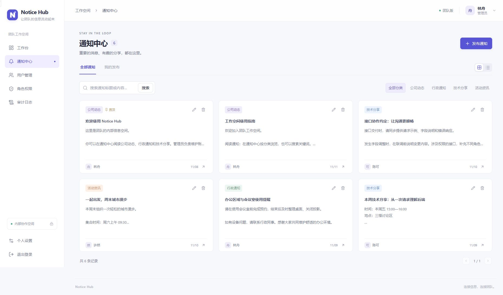

# 浏览器验收

2026年11月11日，在本机Edge实际操作已运行的Notice Hub。页面连接真实Spring Boot、MySQL和Redis服务。

| 检查项 | 实际观察 |
|---|---|
| 管理员登录 | 登录成功，工作台显示真实通知数、成员数和活动记录 |
| 管理导航 | 管理员可访问工作台、通知、用户、角色、日志和个人设置 |
| 发布通知 | 通过表单发布“工作空间使用指南”，列表新增、全员可读 |
| 发布审计 | 日志筛选“发布通知”后看到对应通知和成功结果 |
| 用户管理 | 显示四个演示成员、角色、状态和操作；新增用户表单正常打开 |
| 角色矩阵 | 显示三种角色、对应人数和11项权限 |
| 个人设置 | 显示本人账号资料、显示名输入和验证旧密码的修改密码表单 |
| 员工导航 | 只显示工作台、通知中心和个人设置 |
| 员工详情 | 可以阅读“工作空间使用指南”，无发布和编辑按钮 |
| 员工直达管理页 | 直接访问管理页面地址后，路由返回工作台 |
| 编辑数据范围 | 编辑账号只在本人创建的两条通知上显示编辑、删除操作 |
| 编辑表单与保存 | 打开本人通知、提交保存，弹窗关闭并出现更新成功提示 |
| 空搜索结果 | 搜索不存在的关键词，显示空状态和修改关键词提示 |
| 分类筛选 | 选择技术分享后显示两条对应通知 |
| 视图切换 | 可以从卡片视图切换为列表视图 |
| 退出与账号切换 | 管理员、员工、编辑分别登录，导航与操作权限随身份变化 |
| 页面刷新 | 保持当前会话，重新读取真实数据 |
| 页面滚动 | 新路由回到顶部；最终通知中心检查scrollY为0 |
| 最终页面 | 保留管理员通知中心，显示六条通知和完整导航 |

完整后端权限与数据校验见 `验收结果.md`，包括通过直接API请求进行的越权、密码变更、停用、会话过期和限流验证。浏览器中的密码表单只检查展示，密码变更流程由专用临时账号的接口测试验证。

浏览器测试发现原弹窗容器的通用类名被隐藏样式命中；改用项目专属 `nh-dialog-layer` 后，发布、详情和新增用户弹窗均正常显示。页面跳转的滚动位置采用[Vue Router官方scrollBehavior方案](https://router.vuejs.org/guide/advanced/scroll-behavior.html)。

最终截图：

