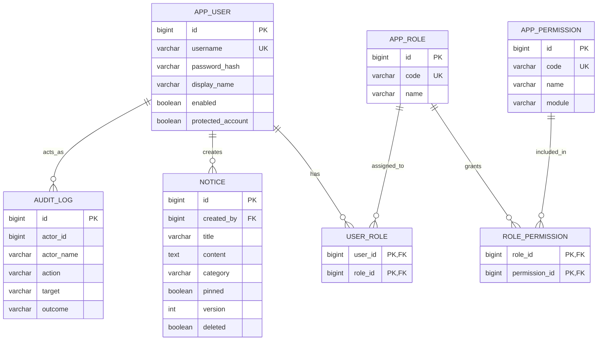
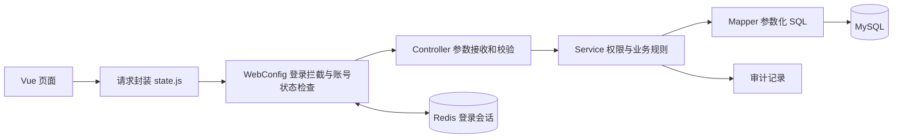

# 需求与设计

## 目标与边界

项目为小型公司的内部信息发布提供账号认证、通知管理和权限控制。学习目标是能够解释一次请求如何被识别、授权、执行业务并保存结果，也能根据失败用例判断规则是否正确。

第一版提供完整的本地后端和浏览器前端，账号由管理员创建；通知发布后全体已登录成员可见。三种角色及其权限预先定义，管理员为用户分配角色，一个用户可拥有多个角色，权限取并集。

项目的业务扩展边界：审批、附件、公开注册、短信登录、第三方登录、多租户和微服务可另开需求迭代。当前部署范围为本机，外部部署需要确定域名、HTTPS、数据库备份、密钥管理、访问量和运维策略。

## 角色与规则

| 能力 | 员工 | 编辑 | 管理员 |
|---|---|---|---|
| 阅读全部通知 | 允许 | 允许 | 允许 |
| 查看本人资料、修改本人密码 | 允许 | 允许 | 允许 |
| 创建通知 | 拒绝 | 允许 | 允许 |
| 修改、删除本人通知 | 拒绝 | 允许 | 允许 |
| 修改、删除他人通知 | 拒绝 | 拒绝 | 允许 |
| 置顶通知 | 拒绝 | 拒绝 | 允许 |
| 创建、查询、编辑和启停用户 | 拒绝 | 拒绝 | 允许 |
| 查看角色及权限、分配角色 | 拒绝 | 拒绝 | 允许 |
| 查询审计记录 | 拒绝 | 拒绝 | 允许 |

角色是权限的组合。接口判断权限码；通知修改和删除还判断创建人。管理员管理全部通知使用 `notice:manage`，编辑使用 `notice:update:own` / `notice:delete:own` 并检查当前用户ID等于 `created_by`。

初始管理员是受保护账号，不能停用或调整角色。其他管理员也不能通过管理接口改变自己的账号状态或角色，避免误操作导致失去管理入口。当前项目通过初始管理员保留一个稳定的恢复入口。

## 功能验收目标

| 编号 | 目标 | 验证方法 |
|---|---|---|
| F01 | 正确账号密码可登录，错误密码不可登录 | 发送两组真实请求 |
| F02 | 登录有效期固定两小时，不自动续期 | 核对配置和Redis实际TTL |
| F03 | 无凭证、退出或过期后不能访问受保护接口 | HTTP 401 |
| F04 | 已登录但权限不足 | HTTP 403 |
| F05 | 编辑不能操作其他编辑的通知 | 用另一位编辑Token提交同一通知ID |
| F06 | 禁用账号后所有旧会话失效，无法重新登录 | 两个Token和一次重新登录请求 |
| F07 | 角色增减在原Token下一个请求生效 | 连续分配和撤销角色后请求 |
| F08 | 密码修改验证旧密码，注销全部登录 | 原密码、旧Token、新密码依次验证 |
| F09 | 搜索、分类、本人筛选和分页正确 | 组合查询；分页上限100 |
| F10 | 通知版本冲突不覆盖已保存修改 | 相同旧版本提交两次，第二次409 |
| F11 | 关键操作有审计记录 | 通过审计接口查询 |

## 安全与输入约束

- 密码存 Argon2id 哈希，每个密码独立随机盐；参数为19 MiB内存、2轮、并行度1。数据库和接口分离，实体中的密码哈希被标记为不可序列化。
- Token由Sa-Token生成并保存在Redis。浏览器仅通过 `noticehub-token: Bearer <token>` 请求头提交；不接受Cookie和请求体中的Token。
- 浏览器把Token放在 `sessionStorage`，刷新可继续使用，关闭标签页后需要重新登录；脚本注入风险通过纯文本渲染、输入边界和CSP等措施控制。
- 同一用户名连续5次失败后，在本轮10分钟计数窗口内限制登录；Lua脚本保证计数与首次过期设置原子执行。
- 用户名3—32位，以字母开头，可含数字或下划线，统一小写、唯一；显示名最多40字。
- 新密码10—128位，包含字母和数字。此长度和复杂度约定服务于当前教学项目。
- 通知标题最多120字、正文最多20000字；分类从四个预设值中选择。客户端不能设置创建人。
- SQL使用参数绑定；请求DTO拒绝未声明字段，避免把数据库实体直接作为可写请求。

“默认拒绝、逐次检查、明确用户与资源操作”来自[OWASP鉴权建议](https://cheatsheetseries.owasp.org/cheatsheets/Authorization_Cheat_Sheet.html)；密码哈希方案参考[OWASP密码存储建议](https://cheatsheetseries.owasp.org/cheatsheets/Password_Storage_Cheat_Sheet.html)。用户名、分类、有效期和重试窗口是项目选择。

## 数据关系

审计中的用户关系是逻辑关联，数据库未设置外键。记录同时保存操作人显示名，后续账号状态或名称变化不会抹去当时的操作人说明。`Flyway` 另有一张迁移历史表，不属于业务表。

## 请求分工

Controller保持简短，业务规则集中在Service。数据访问使用Mapper，前端样式和角色展示不决定后端是否授权。SQL迁移脚本负责建表，Java初始化器只在显式启用演示数据且用户表为空时插入示例，重启不会覆盖已有账号或密码。

## 性能与维护指标

先以功能和权限正确性验收，再记录本机读请求基线。实际并发次数、成功率和耗时见 `验收结果.md`；该基线对应当前机器与小数据量。并发容量目标需要在明确硬件、数据规模和业务组合后制定。

当前可维护性检查项：按职责分包；请求DTO与实体分离；统一响应和异常；版本化数据库迁移；可重复构建；本地凭据不进入Git；关键权限可用独立脚本重复验证。
